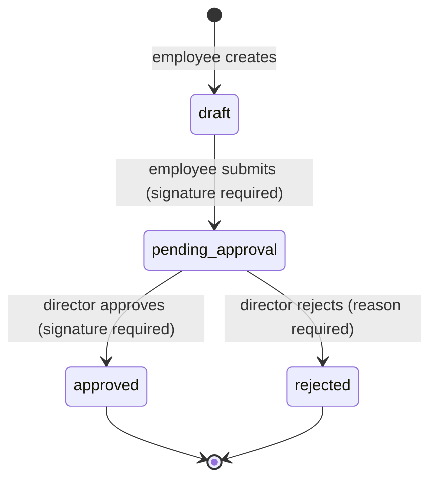
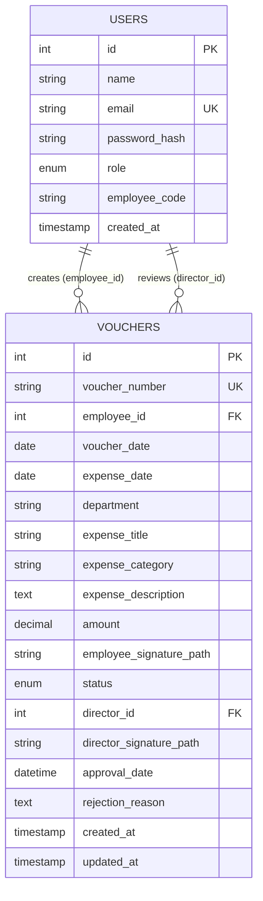

# Expense Voucher Management System

A full-stack web application that replaces a paper-based expense reimbursement process.
Employees create and submit expense vouchers, the Director approves or rejects them with a
signature or a reason, and the Accounts team monitors every submitted voucher for payment.

## Table of contents

1. [Features](#features)
2. [Tech stack](#tech-stack)
3. [Project structure](#project-structure)
4. [Setup instructions](#setup-instructions)
5. [Test accounts](#test-accounts)
6. [Voucher workflow](#voucher-workflow)
7. [Database schema](#database-schema)
8. [API documentation](#api-documentation)
9. [Validation and business rules](#validation-and-business-rules)
10. [Security](#security)
11. [Assumptions](#assumptions)
12. [Known limitations and future work](#known-limitations-and-future-work)

## Features

**Employee**
- Log in, create a voucher, save it as a draft, edit or delete drafts
- Upload a signature image and submit the voucher for approval
- See only their own vouchers, with status, details and the rejection reason if rejected
- Dashboard: total, draft, pending, approved and rejected counts, and total amount claimed

**Director**
- See every submitted voucher, and a dedicated Pending Approvals list
- Search, filter and sort vouchers
- Approve (with a signature upload) or reject (with a required reason)
- Dashboard: pending count, approved today, rejected today, total pending amount, recent activity

**Accounts team**
- Read-only view of every submitted voucher, including both signatures and the approval status
- Search, filter and sort vouchers; print a voucher (use "Save as PDF" in the print dialog to download)
- Dashboard: totals by status, total approved expense amount, recent approved vouchers

**General**
- JWT authentication with role-based access control, enforced on the server and in the UI
- Responsive layout that works on phones and desktops
- Form validation in the browser and again on the server

## Tech stack

| Layer | Technology |
|---|---|
| Frontend | React (Vite), React Router, Axios, plain CSS |
| Backend | Node.js, Express, JWT (`jsonwebtoken`), `bcrypt`, Multer (file uploads) |
| Database | MySQL 8.0.16 or newer (`mysql2` driver) |

## Project structure

```
.
├── README.md
├── backend/
│   ├── .env.example
│   ├── schema_mysql.sql          database schema (run this first)
│   ├── package.json
│   ├── uploads/signatures/       uploaded signature images (created automatically, not in Git)
│   └── src/
│       ├── server.js             app entry point
│       ├── db.js                 MySQL connection pool
│       ├── seed.js               creates the test users
│       ├── middleware/
│       │   ├── auth.js           authenticate (JWT) and authorize (role)
│       │   └── upload.js         Multer config for signature images
│       ├── routes/
│       │   ├── auth.js           login
│       │   ├── vouchers.js       voucher APIs
│       │   └── dashboard.js      dashboard numbers
│       └── utils/voucherQuery.js search, filter and sort query builder
└── frontend/
    ├── .env.example
    └── src/
        ├── main.jsx, App.jsx     entry point and route table
        ├── api.js                Axios instance (adds the token, handles expired logins)
        ├── context/AuthContext.jsx
        ├── components/           ProtectedRoute, Layout, VoucherList, VoucherForm,
        │                         VoucherDetails, ReviewPanel, StatCard, StatusBadge
        ├── pages/                Login, Dashboard, NotFound
        └── utils/                roles.js, format.js
```

## Setup instructions

### Prerequisites

- Node.js 18 or newer
- MySQL 8.0.16 or newer (older versions silently ignore the `CHECK` constraints used in the schema)

### 1. Get the code

```bash
git clone <your-repository-url>
cd <repository-folder>
```

### 2. Create the database

```bash
mysql -u root -p < backend/schema_mysql.sql
```

This creates the `expense_voucher` database with the `users` and `vouchers` tables.

### 3. Start the backend

```bash
cd backend
npm install
cp .env.example .env        # on Windows PowerShell: Copy-Item .env.example .env
```

Open `.env` and set `DB_PASSWORD` to your MySQL password and `JWT_SECRET` to a long random string.

```bash
npm run seed                # creates the test users (safe to run again)
npm run dev                 # starts the API on http://localhost:5000 with auto-reload
```

Use `npm start` instead of `npm run dev` to run without auto-reload.
Check that it works: open <http://localhost:5000/api/health>, you should see `{"status":"ok"}`.

If `npm install` fails while building `bcrypt` (this can happen on Windows), install `bcryptjs`
instead and change the two `require('bcrypt')` lines in `src/routes/auth.js` and `src/seed.js`.

### 4. Start the frontend

In a second terminal:

```bash
cd frontend
npm install
cp .env.example .env        # on Windows PowerShell: Copy-Item .env.example .env
npm run dev                 # http://localhost:5173
```

Open <http://localhost:5173>. Use `localhost`, not `127.0.0.1`: the backend only allows the
origin configured in `CLIENT_URL`.

### Environment variables

**backend/.env**

| Variable | Meaning | Example |
|---|---|---|
| `PORT` | API port | `5000` |
| `DB_HOST` | MySQL host | `localhost` |
| `DB_USER` | MySQL user | `root` |
| `DB_PASSWORD` | MySQL password | `your_mysql_password` |
| `DB_NAME` | Database name | `expense_voucher` |
| `JWT_SECRET` | Secret used to sign tokens | a long random string |
| `JWT_EXPIRES_IN` | Token lifetime | `1d` |
| `CLIENT_URL` | Allowed frontend origin (CORS) | `http://localhost:5173` |

**frontend/.env**

| Variable | Meaning | Example |
|---|---|---|
| `VITE_API_URL` | Where the backend is running | `http://localhost:5000` |

## Test accounts

Created by `npm run seed`. The password for all accounts is `Password@123`. These are
development credentials only.

| Role | Email | Employee ID |
|---|---|---|
| Employee | `employee@test.com` | EMP001 |
| Employee (second, to test privacy between employees) | `employee2@test.com` | EMP002 |
| Director | `director@test.com` | |
| Accounts team | `accounts@test.com` | |

## Voucher workflow



- Only `draft` vouchers can be edited or deleted, and only by the employee who created them.
- `pending_approval`, `approved` and `rejected` vouchers are read-only for everyone.
- Approved vouchers are visible to the Accounts team for reimbursement.

## Database schema



The full definition is in [`backend/schema_mysql.sql`](backend/schema_mysql.sql).

### `users`

One table for all three roles. The `role` column (`employee`, `director`, `accounts`) decides
what a user may do. Passwords are stored only as bcrypt hashes. `employee_code` holds the
optional Employee ID.

### `vouchers`

| Column | Notes |
|---|---|
| `voucher_number` | Unique, generated by the backend as `VCH-<year>-<id padded to 4 digits>`, for example `VCH-2026-0001` |
| `employee_id` | Foreign key to `users`: who created the voucher |
| `voucher_date` | Defaults to the day the voucher was created |
| `expense_date`, `department`, `expense_title`, `amount` | Required |
| `expense_category`, `expense_description` | Optional |
| `employee_signature_path`, `director_signature_path` | Path of the image file; the image itself is stored on disk |
| `status` | `draft`, `pending_approval`, `approved` or `rejected` |
| `director_id` | Foreign key to `users`: who approved or rejected |
| `approval_date` | Set on approval |
| `rejection_reason` | Set on rejection |
| `created_at`, `updated_at` | Audit columns; `updated_at` changes automatically |

### Rules enforced by the database itself

These are `CHECK` constraints, so even a bug in the application cannot save invalid data:

- `amount > 0`
- A voucher that is not a draft must have an employee signature
- An approved voucher must have a director signature
- A rejected voucher must have a rejection reason

## API documentation

Base URL: `http://localhost:5000/api`. All endpoints except login and health need the header
`Authorization: Bearer <token>`.

**Status codes used everywhere**

| Code | Meaning |
|---|---|
| 200 / 201 | Success / created |
| 400 | Invalid input (the body lists the problem fields) |
| 401 | Not logged in, or the token is invalid or expired |
| 403 | Logged in, but this role may not do this |
| 404 | Not found, or not visible to this user |
| 409 | The voucher is in the wrong state for this action |

Validation errors look like:

```json
{ "message": "Validation failed", "errors": { "amount": "Amount must be greater than 0" } }
```

### Authentication

| Method and path | Who | Description |
|---|---|---|
| `POST /auth/login` | anyone | Body `{ "email", "password" }`. Returns `{ "token", "user": { id, name, email, role } }`. `401` for a wrong email or password. |
| `GET /auth/me` | logged in | Returns the user decoded from the token. |
| `GET /health` | anyone | Returns `{ "status": "ok" }`. |

### Vouchers

| Method and path | Who | Description |
|---|---|---|
| `POST /vouchers` | employee | Creates a draft. Body: `expense_date` (YYYY-MM-DD), `department`, `expense_title`, `amount`, optional `expense_category`, `expense_description`. Returns `201 { id, voucher_number, status }`. |
| `GET /vouchers` | all roles | Lists vouchers (see the filters below). Employees get only their own; the Director and Accounts get all submitted vouchers. |
| `GET /vouchers/:id` | all roles | Full details, including the employee and director names and signature paths. `404` if it is not yours (employee) or is a draft (Director, Accounts). |
| `PUT /vouchers/:id` | employee (owner) | Edits a draft. Same body as create. `409` if it is no longer a draft. |
| `DELETE /vouchers/:id` | employee (owner) | Deletes a draft and its signature file. `409` if it is no longer a draft. |
| `POST /vouchers/:id/signature` | employee (owner) | Uploads the employee signature. `multipart/form-data`, field `signature`, PNG or JPG, max 2 MB. Returns `{ employee_signature_path }`. |
| `POST /vouchers/:id/submit` | employee (owner) | Draft becomes `pending_approval`. `400` if no signature has been uploaded. |
| `POST /vouchers/:id/approve` | director | `multipart/form-data`, field `signature` (the Director's signature). Sets status `approved`, the director and the approval date. `409` if the voucher is not pending. |
| `POST /vouchers/:id/reject` | director | Body `{ "reason": "..." }` (required, up to 1000 characters). Sets status `rejected`. `409` if the voucher is not pending. |

**Filters for `GET /vouchers`** (all optional, combined with AND)

| Query parameter | Meaning |
|---|---|
| `q` | Search voucher number, employee name or expense title |
| `voucher_number`, `employee_name`, `department`, `category` | Partial text match |
| `status` | `draft`, `pending_approval`, `approved` or `rejected` |
| `date_from`, `date_to` | Expense date range (YYYY-MM-DD) |
| `min_amount`, `max_amount` | Amount range |
| `sort_by` | `id`, `voucher_number`, `voucher_date`, `expense_date`, `amount`, `status`, `employee_name` |
| `order` | `asc` or `desc` (default `desc`) |

Example: `GET /vouchers?status=approved&min_amount=1000&sort_by=amount&order=asc`

### Dashboard

`GET /dashboard` returns the numbers for the logged-in user's role.

```json
// employee
{ "role": "employee", "stats": { "total": 3, "drafts": 1, "pending": 0, "approved": 1, "rejected": 1, "total_amount_claimed": 3500.5 } }

// director
{ "role": "director", "stats": { "pending_count": 2, "approved_today": 1, "rejected_today": 0, "total_pending_amount": 3500.5 }, "recent": [ ... ] }

// accounts
{ "role": "accounts", "stats": { "total": 2, "pending": 0, "approved": 1, "rejected": 1, "total_approved_amount": 1000 }, "recent": [ ... ] }
```

### Uploaded files

Signature images are served from `GET /uploads/signatures/<file name>`. The file path is stored
on the voucher as `employee_signature_path` and `director_signature_path`.

## Validation and business rules

| Rule | Where it is enforced |
|---|---|
| Department, expense title, expense date and amount are required | Browser, API, and `NOT NULL` columns |
| Amount must be greater than 0 | Browser, API, and a `CHECK` constraint |
| Employee signature required before submitting | Browser, API, and a `CHECK` constraint |
| Director signature required before approving | Browser, API, and a `CHECK` constraint |
| Rejection reason required when rejecting | Browser, API, and a `CHECK` constraint |
| Voucher numbers are unique and generated automatically | `UNIQUE` column; generated inside a transaction |
| New vouchers start as `draft` | Column default |
| Only the owner can edit or delete, and only in `draft` | API (ownership and status check) |
| Submitted, approved and rejected vouchers are read-only | API (`409`) |
| Only the Director can approve or reject, and only pending vouchers | API (role check, then status check) |
| Employees see only their own vouchers | API (the filter cannot be removed from the URL) |

## Security

- Passwords are hashed with bcrypt; plain passwords are never stored.
- Login returns a signed JWT (default lifetime one day). Every protected endpoint verifies it.
- Role checks happen on the server for every action. The protected routes in the React app only
  improve the user experience; they are not what keeps data safe.
- All SQL uses parameter placeholders. Sort columns come from a fixed allow-list, so they cannot
  be used for SQL injection.
- Uploads accept only PNG and JPG up to 2 MB, are stored under a name the server chooses, and are
  deleted again if the request is rejected.
- CORS only allows the origin set in `CLIENT_URL`.
- A voucher that belongs to someone else returns `404`, not `403`, so its existence is not revealed.
- Two reviewers cannot both decide the same voucher: the update only applies while the voucher is
  still pending.

## Assumptions

The assignment leaves these points open. This is how they were decided.

1. **Status values.** "Submitted" and "Pending Approval" are merged: submitting a voucher moves it
   straight to `pending_approval`.
2. **Drafts are private.** The Director and Accounts see submitted vouchers only (pending,
   approved, rejected), because a draft is unfinished work and nothing about it needs reviewing.
   Their dashboard totals therefore exclude drafts. Showing drafts too would be a small change in
   `utils/voucherQuery.js`, the voucher details route, and `routes/dashboard.js`.
3. **When the signature is needed.** Saving a draft does not need a signature. Submitting does,
   and so does approving.
4. **Signatures are per voucher.** The employee uploads a signature for each voucher, and the
   Director uploads one for each approval.
5. **Users are seeded.** There is no sign-up screen, so `npm run seed` creates one user per role
   (plus a second employee). The Employee ID is part of the user record.
6. **Voucher number format.** `VCH-<year>-<4-digit id>`. It is generated in the backend right
   after the insert, inside a transaction, because MySQL cannot build it from the auto-increment
   id inside the table definition.
7. **Date range filter.** It filters on the expense date.
8. **"Total Amount Claimed"** (employee dashboard) sums submitted vouchers, so drafts are excluded.
9. **"Rejected Today"** (Director dashboard) uses the voucher's last-updated time, because a
   rejected voucher is locked and its last update is the moment of rejection.
10. **Currency** is Indian Rupees (INR), shown in the Indian number format.
11. **Expense categories** are a fixed list in the form (Travel, Meals, Accommodation, Office
    Supplies, Equipment, Fuel, Training, Other). The API accepts any text of up to 50 characters.
12. **Download or print** uses the browser's print dialog, which can also save a PDF.
13. **Signature images are public files.** They are served as static files, because an ``
    tag cannot send an Authorization header.
14. **Login session.** The token is kept in `localStorage` so a page refresh keeps you signed in.
    It expires after one day, after which the user is sent to the login page.
15. **Time zone.** "Today" on the dashboards means the database server's current date.

## Known limitations and future work

- The voucher list is not paginated; it loads every matching voucher at once.
- Signature images are not access-protected (see assumption 13). A production version would serve
  them through an authenticated endpoint or private cloud storage.
- The JWT in `localStorage` is readable by scripts running on the page. A production version
  could use an HttpOnly cookie with a refresh token.
- No rate limiting on the login endpoint.
- No automated test suite is included in the repository.
- No email or in-app notifications when a voucher is approved or rejected.
- No screen for managing users; users are created by the seed script.

<!--
## Screenshots

Add images to a docs/screenshots folder, then uncomment and edit these lines.


-->
